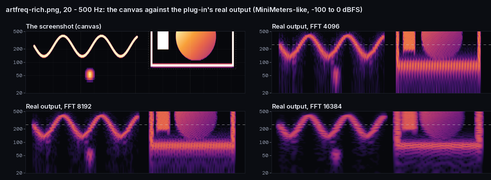

# Are the screenshots accurate?

## In plain words (since the measured preview)

**Yes, for screenshots taken with this version.** The canvas no longer shows an ideal picture of
the drawing: a moment after each change it renders one pass of the plug-in's real output (the same
sound as playback and Bounce WAV) and shows it as a spectrogram analyser with your settings shows
it (Hann window, the FFT size and colour levels from Settings: 8192 points and -100 to 0 dBFS by
default). So the blur and thickening below about 250 Hz, the faint haze under bright low shapes,
the scan lines in the highs at the default Density and the analyser's colours are all on the
canvas now, because they are in the sound and in every analyser. The Live view uses the same
analysis and colours, so the same sound looks the same in both.

- **ArtFreq:** the canvas is its real output, analysed. Checked against the real processor's
  output analysed separately (the truth lab, below): correlation 0.95 - 1.00 in every band and at
  FFT 4096, 8192 and 16384 (each canvas at that FFT size), mean difference within 0.2 dB, and the
  drawing stands out no more on the canvas than in reality (excess contrast -0.6 to +0.1 dB). The
  old canvas: correlation as low as 0.40 in the lows and a drawing that stood out 29 - 88 dB more
  than in reality (white on black against the analyser's colours).
- **ArtFreq FX:** the canvas is the real carver's output on a **stand-in song** (it does not have
  yours), now shaped like a loud master (5 dB an octave towards the highs, a kick and a bass
  line). Against the dense test master: correlation 0.62 - 0.98 by band and mode (old: 0.14 -
  0.89), mean difference within 2 dB, and carved shapes stand out at most 4 dB more on the canvas
  than on the master (old: up to 36 dB, in the lows). The lows now show what carving does there:
  the small dot at 50 Hz and the logo's bottom edge mostly vanish, as on the master. A real song
  differs from the stand-in (its bass may be brighter or quieter), which the help says.
- **While you drag, paint or type** the canvas shows a quick estimate of the same picture (the
  analyser's blur and colours, less exactly in the lows: the shimmer and some of the haze are only in
  the sound) and fades to the
  measured one when you stop; a line under the canvas says which ("Updating…", "Preview of the
  real sound"). Screenshots should be taken once it says the latter (the snapshot tool does).
- **The screenshots in `docs/screenshots` and the website's are of the old canvas**: re-shoot them
  with this version (`ArtFreqSnapshot`), and they are accurate for the plug-in's output at the
  default analyser settings (FFT 8192, -100 to 0 dBFS, log 20 Hz - 20 kHz). Until then the
  guidance below for the old screenshots stands.

The rest of this page first gives the measurements of the new canvas, then the audit of the old
one, which led to it.

## The new canvas against the real output

`ArtFreqTruthLab <after> <out> --before <before>` (see Reproduce): for each audited state, the old
screenshot's canvas, the new canvas (rendered exactly as the editor renders it, at each FFT size)
and the real output (the activated processor, played as a DAW plays it, ArtFreq FX on the dense
test master, analysed by the lab's own code), per band: lows below 250 Hz, low mids 250 Hz -
2 kHz, highs above 2 kHz. All levels as the analyser's colour key reads them (-100 to 0 dBFS,
clipped to it). **r**: correlation of canvas and real over the band; **mean**: canvas - real (dB);
**excess**: how much more the canvas makes of the drawing than reality (its contrast between
drawn cells and the cells around them, against the real contrast; > 0: the canvas looks better
than it is). At FFT 8192 (the default), old -> new:

| State | Band | r | mean dB | excess dB |
| --- | --- | --- | --- | --- |
| default | low mids | 0.85 -> 0.99 | 3.2 -> -0.1 | 36.9 -> 0.0 |
| default | highs | 0.84 -> 1.00 | 1.5 -> 0.0 | 57.5 -> 0.0 |
| rich | lows | 0.62 -> 0.96 | -10.4 -> 0.1 | 45.0 -> -0.5 |
| rich | low mids | 0.85 -> 0.99 | 2.6 -> 0.0 | 32.4 -> 0.0 |
| rich | highs | 0.76 -> 1.00 | 4.7 -> 0.0 | 48.4 -> -0.1 |
| layers | lows | 0.56 -> 0.96 | -15.1 -> 0.2 | 61.4 -> -0.3 |
| layers | low mids | 0.84 -> 0.99 | 2.1 -> 0.0 | 32.6 -> 0.0 |
| layers | highs | 0.73 -> 1.00 | 7.5 -> 0.0 | 54.0 -> 0.0 |
| linear | lows | 0.64 -> 1.00 | 0.2 -> 0.0 | 71.4 -> 0.1 |
| linear | low mids | 0.56 -> 1.00 | -1.5 -> 0.0 | 38.0 -> 0.0 |
| linear | highs | 0.63 -> 1.00 | -2.4 -> 0.0 | 46.3 -> 0.0 |
| fx-default | low mids | 0.82 -> 0.92 | -7.0 -> 1.6 | -4.6 -> 2.5 |
| fx-default | highs | 0.61 -> 0.66 | -3.2 -> 1.1 | -1.7 -> 2.6 |
| fx-carve | lows | 0.52 -> 0.90 | -8.3 -> 2.0 | 34.3 -> 1.4 |
| fx-carve | low mids | 0.78 -> 0.89 | -7.1 -> 1.4 | -0.6 -> -0.3 |
| fx-carve | highs | 0.77 -> 0.85 | -4.2 -> 1.0 | 4.1 -> 0.5 |
| fx-carve-draw | lows | 0.33 -> 0.89 | -4.9 -> 1.6 | 6.6 -> 2.1 |
| fx-carve-draw | low mids | 0.32 -> 0.65 | -9.6 -> 0.8 | 3.7 -> -1.3 |
| fx-carve-draw | highs | 0.32 -> 0.76 | -5.8 -> 0.7 | -4.0 -> -2.5 |
| fx-stencil | lows | 0.40 -> 0.98 | -15.1 -> 0.2 | -9.1 -> 4.0 |
| fx-stencil | low mids | 0.68 -> 0.95 | -6.8 -> 0.6 | -18.6 -> 1.5 |
| fx-stencil | highs | 0.82 -> 0.97 | -2.0 -> 0.4 | -0.9 -> 2.6 |

(The default drawings have nothing in the lows. For ArtFreq FX the remaining differences are the
songs': the stand-in is one song, the test master another; their medians agree within 1 - 4 dB
per band, and r is limited by the songs' own patterns, which differ.) At FFT 4096 and 16384 the
same holds: ArtFreq r 0.95 - 1.00, |mean| within 0.2 dB, excess -0.6 to 0.1 dB; ArtFreq FX r 0.62 -
0.98, |mean| within 2 dB, excess -2.7 to +4.0 dB. The editor's screenshot and the direct render
agree to a median 0.0 - 0.1 dB.

**Verdict: no band where the new canvas looks clearly better than reality** (at most 4 dB more
contrast, in ArtFreq FX's lows on a different song; ArtFreq none).

The quick estimate shown while dragging is close but not exact: ArtFreq correlation 0.76 - 0.98,
excess contrast within 9 dB in the low mids and highs and in the lows with Smooth lows; on a
linear scale's lows (a few rows) it leaves out a haze the sound has (excess up to 35 dB there).
It is replaced by the measured picture as soon as the drawing stays still.

Side by sides (old canvas | new canvas | real output at 8192, the other FFT sizes under them, the
numbers at the foot) come out of the lab as `truth-<state>.png`.

## The old canvas (0.5): the audit

### What to put on the website (for the old screenshots)

1. **Lead with real measurements**, captioned as such: `docs/marketing/artfreq-real-output.png`,
   `artfreq-real-output-text.png` and `artfreq-fx-real-output.png` (real analyses of the plug-ins'
   audio), and the demo clips (`docs/marketing/*-demo.mp4` and `.gif`, made with the demo reel
   tool: the plug-ins' own window filmed while they play, with their Live view of the real output).
2. **Safe with a caption:** `artfreq-default.png` and `artfreq-fx-default.png`. Any interface
   screenshot is fine *to show the interface*, with the caption.
3. **Do not present as "what you will see":** artfreq-layers, artfreq-fx-carve,
   artfreq-fx-carve-draw, artfreq-linear, and artfreq-rich / -on-play (their low parts).
4. **Test content:** every screenshot with a drawing except `artfreq-default.png` and
   `artfreq-fx-default.png` shows the test drawing: the word HELLO and a test picture named
   `logo.png` (in the layer list too). That includes `artfreq-live.png`, which is otherwise a real
   analysis. Fine in the documentation; on the website it looks like a placeholder, so better
   re-shot with a real drawing (see Fixes) or replaced by a demo clip's poster frame.

Captions, ready to paste:

- Under an ArtFreq canvas screenshot: *"The canvas previews your spectrogram. Text and shapes in the
  mids and highs come out as drawn; below about 150 Hz every analyser blurs detail, so keep low art
  big and simple. Colours depend on your analyser's settings."*
- Under an ArtFreq FX canvas screenshot: *"The canvas previews the carve over a stand-in texture,
  not your song; the Live view shows the real result. Carving reads best in the mids and highs: in
  the bass, a song's kick and bass fill small shapes back in."*
- Under a real-output image: *"Real measurement of ArtFreq's output, not a mock-up."* For the FX
  image add *"on a synthetic test song"*.

The rest of this page is the detail behind these points.

### How it was checked

For every screenshot with a drawing, the exact drawing and settings were saved from the snapshot
tool and played, one pass, through the real plug-in (activated, as a buyer's copy): ArtFreq on its
own, ArtFreq FX on a dense synthetic master (drums, bass, chords, a voice, cymbals and a noise bed
at -10 dBFS RMS). The output was analysed as an FFT spectrogram such as MiniMeters' works: Hann
window, FFT 4096, 8192 and 16384 points, log scale 20 Hz - 20 kHz, a column every 5 - 7 ms, coloured
with the canvas's colour map over -100 to 0 dBFS, at 48 kHz. (MiniMeters itself was not available
here and its own defaults could not be looked up: its dB range, window and colour map are
assumptions. The shapes do not depend on them; the colours do. "Analysed like MiniMeters" in the
figures means this.)

Each comparison puts the screenshot's canvas beside the real output, at the same size and on the
same frequency axis (`docs/accuracy/compare-*.png`; the full sheets, with 4096 and 16384 and the
numbers, come out of `ArtFreqTruthLab`, see the end). Bands: **lows** below 250 Hz, **low mids**
250 Hz - 2 kHz, **highs** above 2 kHz.



### What is accurate

- **Text and shapes from about 250 Hz up** land where they are drawn, with the right shape, at FFT
  4096 and 8192 (16384 blurs them in time, see 7). ArtFreq's default drawing ("ArtFreq", 300 Hz - 3 kHz): 97 - 98 % of the letters' cells within
  12 dB of what the canvas shows, correlation 0.86 with the canvas at FFT 8192.
- **Smooth lows fill shapes** in the low mids (the logo's disc and bar, the letters' bodies) as
  the canvas shows, with a fine shimmer texture the canvas does not draw.
- **ArtFreq FX, Carve, in the mids and highs**: dark and sharp, as on the canvas. The default
  "ArtFreq" is carved by a median of 59 dB (FFT 8192) to 65 dB (4096) below the song; 69 - 90 %
  of the letters' cells are at least 30 dB darker than the song.
- **Carve + Draw in the highs** stands out more than the canvas shows (+21 dB over the song,
  the canvas +10). **Stencil in the highs** passes the song as shown (97 % within 6 dB).
- **The Live view screenshot** (`artfreq-live.png`) is not a preview: it is a real analysis of the
  sound (FFT 4096), and it agrees with these measurements, blur in the lows included.

### What is not

1. **The lows are blurred and thicker.** An analyser's resolution is a fixed number of Hz
   (Hann, FFT 8192 at 48 kHz: about +-12 Hz; 4096: +-23 Hz; 16384: +-6 Hz). At 1 kHz that is
   nothing; at 100 Hz it is a third of an octave (8192) to two thirds (4096); at 50 Hz, two thirds
   to one and a half octaves. So, in the "rich" screenshot:
   - the soft dot at 40 - 65 Hz shows as an upright streak, about 31 - 74 Hz at FFT 8192 and
     23 - 81 Hz at 4096 (within 20 dB of its peak), with a faint tail up to about 110 Hz;
   - the logo's bottom edge, a thin bar at 80 - 90 Hz on the canvas, shows as a band about
     59 - 110 Hz at 8192 (55 - 115 Hz at 4096, 66 - 103 Hz at 16384): several times as thick;
   - the wave's lower half is softer and thicker than the crisp line on the canvas.

   A longer FFT helps less in the lows than these figures suggest: the Smooth lows are played by
   gliding sines, and a long window sees each one smeared along its glide.
2. **A faint haze under bright low strokes.** Under the logo's bottom edge the analyser shows a
   dim fill down to 20 Hz (about -79 dBFS at 8192, 40 dB under the edge: dark purple on a
   -100 dB scale, black on a -80 dB one), and faint vertical streaks hang under the wave and
   under letters below 2 kHz (about -80 to -95 dBFS for the default "ArtFreq"). The canvas shows
   black there. Unlike the blur, this is in the sound (a long FFT of the output finds it too): energy
   spilled where shapes start and stop and where the Smooth lows' gliding sines enter them. It
   stays 40 dB or more under the drawing.
3. **Text in the low band does not read.** In `artfreq-layers.png` "Bass drop" (100 - 250 Hz) is
   only just legible at 4096 and 8192, and "second line" (40 - 100 Hz) is an unreadable block at
   every FFT size. The canvas shows both as clean letters.
4. **ArtFreq FX in the lows, on a real song.** A song's kick and bass are bright lines (on the test
   master the loudest 5 % of low cells reach -12 dB at FFT 4096, 12 dB over the canvas's stand-in),
   and both the carver and the analyser have only a few bins down there, so they fill small holes
   back in. In `artfreq-fx-carve.png`:
   the black dot at 50 Hz is invisible; the logo's bottom edge (85 Hz) is invisible at 4096 and
   8192; the disc's lower part (below about 150 Hz) is not dark; the median carve below 250 Hz is
   21 - 26 dB, not the 80 dB the black on the canvas suggests (only 31 - 45 % of those cells are
   30 dB under the song). Stencil shows the same lows brighter and thicker than the canvas.
5. **Thin strokes in time vanish in FX at long FFTs.** The logo frame's left and right sides last
   about 70 ms; carved into a song, they are faint at FFT 4096 and gone at 8192 and up (the
   window is longer than the gap). The thin carved wave is a faint line, not the bold black wave
   of the canvas.
6. **The highs show fine horizontal lines at the default Density.** At Density 256 - 384 the
   sine lines above 2 kHz are far enough apart for an analyser at 8192 points to show each one,
   with dark gaps between them, on a display as sharp as the canvas (a Retina screen). The canvas
   fills them in. HELLO in the "rich" screenshot: only 50 % of its cells within 12 dB of the
   canvas at Density 384; **99 % at Density 1024**, where it is solid
   (`docs/accuracy/highs-density.png`). At 150 % and 75 % window size (1x screenshots) the canvas
   does draw these lines, and it matches.
7. **FFT 16384 smears everything in time** (a 0.34 s window): letters run into each other, carved
   letters fill in (FX highs: 26 - 59 % of cells still 30 dB dark, against 76 - 90 % at 4096). A
   short Length makes it worse: `artfreq-linear.png` (1 bar, 2 s) reads at 4096, is blurred at
   8192 and unreadable at 16384.
8. **Colours.** The canvas paints the drawing's loudest point white. ArtFreq's output, at the
   default Level, reaches about -35 to -55 dBFS in an analyser cell, which a -100 to 0 dB scale
   shows orange to pink, never white (the "canvas's colours" panel of each sheet shows the same
   sound with the canvas's mapping). ArtFreq FX's canvas stands a smooth texture in for the song;
   the test master looks brighter in the lows and darker in the mids and highs (by 13 - 21 dB)
   than that stand-in.

### Verdict per screenshot

| Screenshot | Lows (< 250 Hz) | Low mids (250 Hz - 2 kHz) | Highs (> 2 kHz) | Use for marketing? |
| --- | --- | --- | --- | --- |
| artfreq-default | nothing drawn; faint streaks below | accurate | letter tops show fine lines | yes, with the caption |
| artfreq-rich, -on-play, -playing and the other UI states of that drawing | **not accurate**: thicker, blurred, hazy; dot becomes a streak | accurate | HELLO striped, not solid | only to show the interface (test drawing: HELLO, logo.png) |
| artfreq-layers | **not accurate**: low text does not read | accurate | as rich; the sunset striped | no |
| artfreq-linear (1 bar) | small, roughly right | roughly right | blurred at 8192, unreadable at 16384 | no |
| artfreq-150 / -75 (Density 200, 1x) | as rich | accurate | lines shown, and real | only to show the interface |
| artfreq-live | real measurement | real | real | accurate, but shows the test drawing (HELLO, logo.png): a demo clip's poster is better |
| artfreq-fx-default | nothing drawn | accurate (dark, sharp) | accurate | **yes** (best FX shot) |
| artfreq-fx-carve | **not accurate**: dot and bottom edge vanish | big shapes yes; thin wave and frame sides much fainter | accurate at 4096 / 8192 | no |
| artfreq-fx-carve-draw | **not accurate**: dot becomes a dark gap | roughly | accurate, even stronger | not for the lows |
| artfreq-fx-stencil | brighter and thicker than shown | accurate, more colourful | accurate | with the caption (see the note below) |

Note on `compare-fx-stencil.png`: the bright full-height lines at its left and right edges are in
the sound. After the pass, Stencil lets the song through again, as designed. At the pass's start,
which is also where the test song starts, the first 5 ms of the song come through before the
stencil closes (a peak of -4 dBFS fading out over 256 samples): a short tick, which an analyser
draws as a line from top to bottom. Not changed here (it is the plug-in's behaviour); worth a
look by the developer.

### Fixes

#### (a) Marketing: what to show and say

- What to show and the captions: see "What to put on the website" at the top.
- The real-output images: `docs/marketing/artfreq-real-output.png` (ArtFreq's default drawing),
  `artfreq-real-output-text.png` (ARTFREQ over ANYMEANS, Density 1024) and
  `artfreq-fx-real-output.png` (ArtFreq FX carving its default drawing into a dense synthetic
  master). Each is the plug-in's real audio analysed (Hann, FFT 8192, log 20 Hz - 20 kHz, -100 to
  0 dBFS), 2400 x 1280 (1200 x 640 at 2x), captioned as a measurement on the image.
- Cheaper than re-shooting by hand: in the snapshot tool's drawings, replace the test word and
  picture (HELLO, `logo.png`) with real ones, move the low-band parts (the dot at 50 Hz, the
  logo's frame at 70 - 90 Hz, "Bass drop / second line") above about 150 Hz, and use Density 1024
  there; the canvas and the analyser then agree.
- Tell buyers the settings that show it best: FFT 4096 or 8192, Length 4 bars or more for text.

#### (b) The canvas: the smallest changes that would make it honest (since made, and more: see the top)

1. **Show the analyser's blur.** After `CanvasPlanImage` has worked out its levels, blur them as
   an FFT of 8192 points would (the size the Smooth lows are tuned for): vertically by the Hann
   main lobe, +-11.7 Hz turned into canvas rows at each height (wide in the lows, little above
   about 1 kHz), and horizontally by about 85 ms. One separable pass over the picture, in
   `CanvasPlanImage::render` (and over the masks before `EffectPreviewImage` carves its stand-in,
   so thin carved strokes come out faint, as they do). The lows would then look as soft on the
   canvas as in MiniMeters. A later option: an "Analyser FFT" choice (4096 / 8192 / 16384) beside
   Scale and Slope in Settings.
2. **Draw scan lines as the analyser draws them.** `CanvasPlanImage` fills the gap between lines
   that are up to 2 logical pixels apart (4 image pixels on a Retina screen); an analyser of the
   same size shows each line about one pixel tall. Make `maxLineThickness` one device pixel (or
   the FFT's main lobe, where wider). Density 1024 stays solid; Density 256 - 384 shows its lines
   in the highs, as it really does.
3. **ArtFreq FX's stand-in song (optional):** it is flatter than a real master. On the test master
   (bass-heavy, as much current music is) the mids and highs sit 13 and 21 dB lower, against its
   lows, than on the stand-in, and the kick and bass are bright lines. A steeper stand-in with
   brighter bass lines would show the mix as it will look; with change 1 it would also show carved
   shapes in the lows as filled-in as they will be. (One test song: real masters vary.)
4. **Colours:** no change needed in the sound. If the canvas should match MiniMeters' colours,
   it could map absolute dB like the Live view does (its window is -89 to -29 dBFS) instead of
   putting the loudest point at white; otherwise the caption above covers it.

These change only how the canvas looks, not the sound. 1 and 2 make the screenshots less crisp
in the lows and highs: that is the honest picture.

## Reproduce

```
# the old canvas: the snapshot tool of 0.5 (git f347d45), the new one: this version's
ARTFREQ_SNAPSHOT_STATES=1 xvfb-run -a <0.5 build>/ArtFreqSnapshot before 2
ARTFREQ_SNAPSHOT_STATES=1 xvfb-run -a build/ArtFreqSnapshot_artefacts/Release/ArtFreqSnapshot after 2
xvfb-run -a build/ArtFreqTruthLab_artefacts/Release/ArtFreqTruthLab after truth --before before   # truth-<state>.png, metrics.txt
xvfb-run -a build/ArtFreqTruthLab_artefacts/Release/ArtFreqTruthLab --bench                        # the previews' cost
xvfb-run -a build/ArtFreqTruthLab_artefacts/Release/ArtFreqTruthLab --marketing docs/marketing
```

`--states a,b`, `--ffts 4096,8192,16384`, `--range -100,0` and `--wav` choose what is measured
and how it is coloured. The audited states: default, rich, layers, linear, fx-default, fx-carve,
fx-carve-draw, fx-stencil. Everything runs against the test licensing environment (a fake
server); nothing reaches the licence server.
